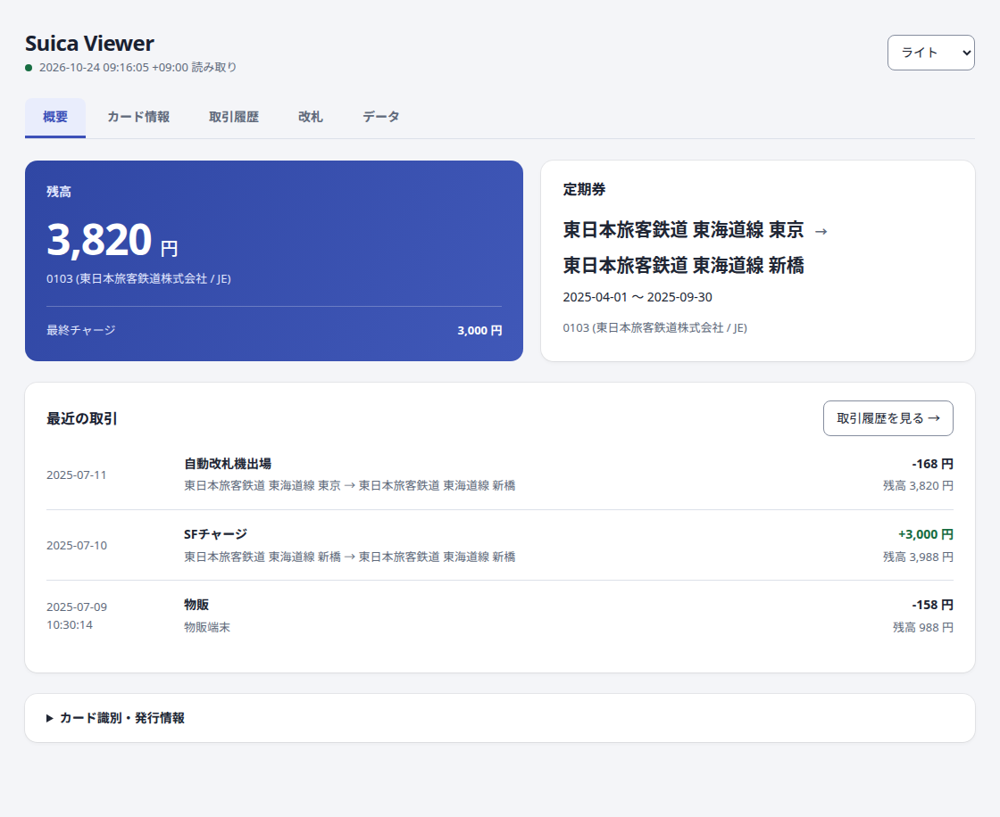
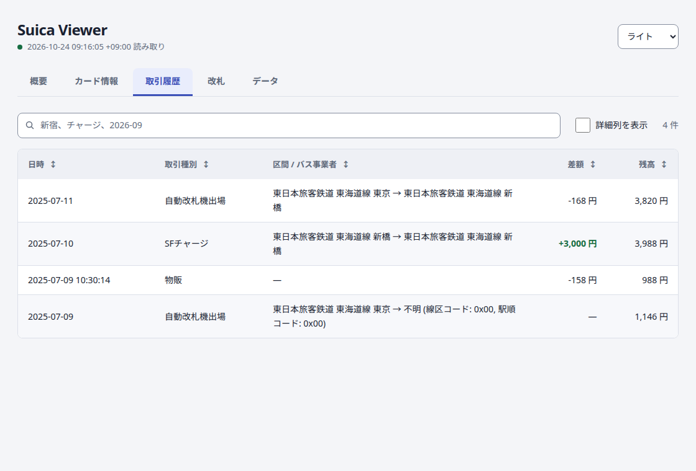
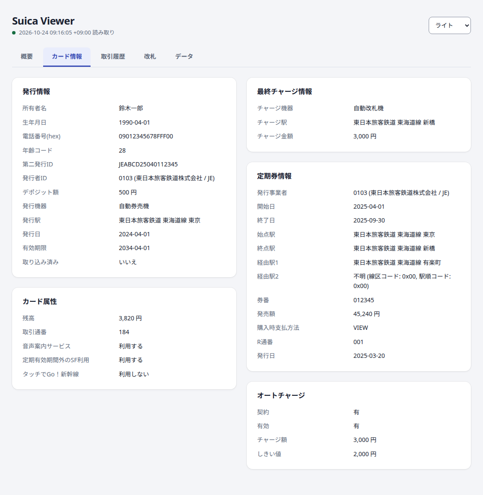
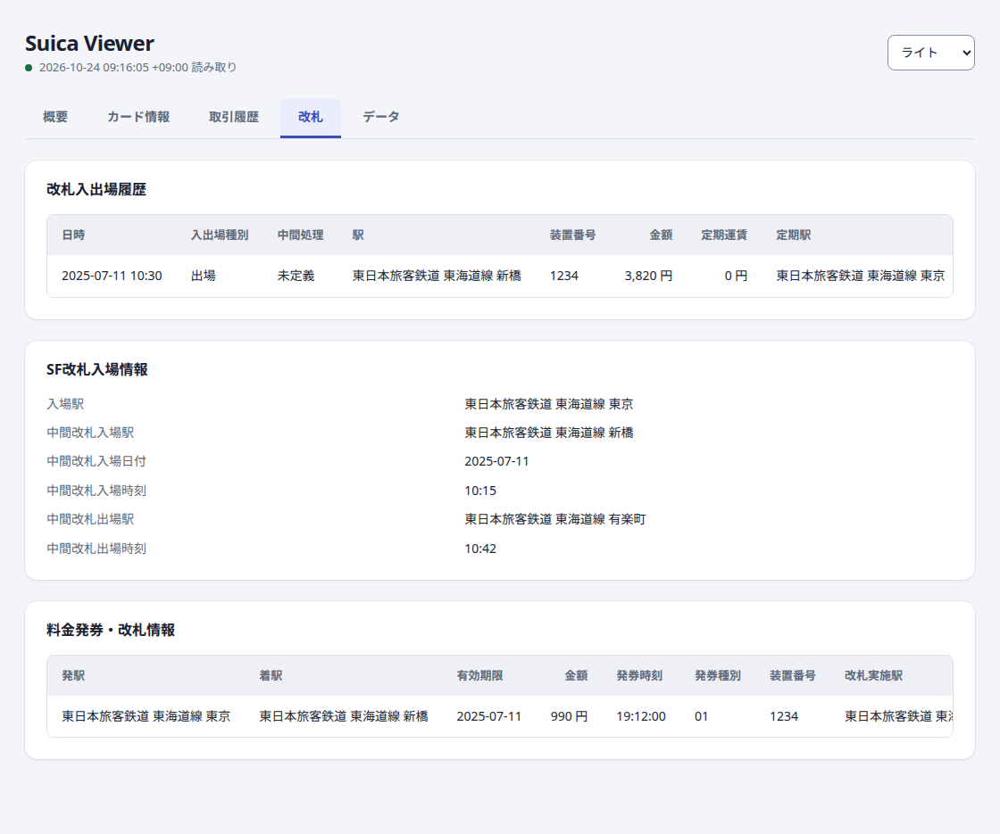
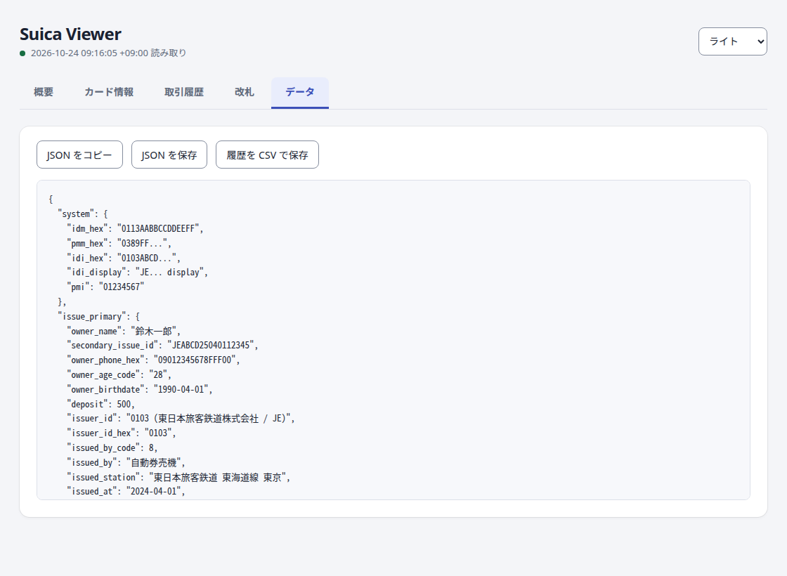
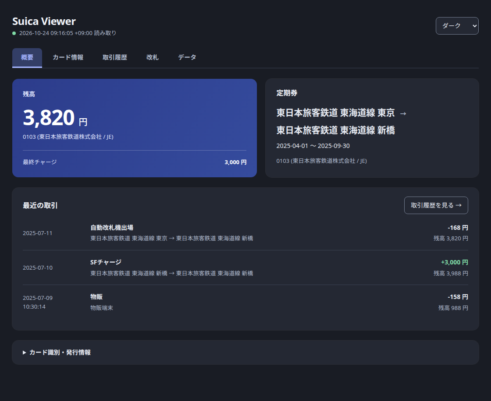

# Suica Viewer

Suica Viewer は、FeliCa 方式の交通系 IC カードから詳しい情報を読み取り、表示・保存するツールです。暗号化された領域はリモートの認証サーバーを使って読み出します。Tauri 製のデスクトップアプリと CLI があります。

リーダーの制御と FeliCa プロトコルには [felica](https://github.com/soltia48/felica-rs) を使っています。

## 主な機能
- 認証サーバーとの相互認証による暗号化領域の読み出し
- デスクトップアプリ: 概要・カード情報・取引履歴・改札・データの各タブ、履歴の検索と並べ替え、JSON・CSV 出力
- CLI: 発行情報・残高・履歴・定期券などを整形して出力
- 会社名・路線名・駅名を `station_codes.csv` から解決（実行ファイルに同梱）
- `AUTH_SERVER_URL` で認証サーバーを変更可能（既定: `https://felica-auth.nyaa.ws`）

## スクリーンショット

同梱のデモデータで表示した画面です。`suica-viewer --demo` で、リーダーがなくても試せます。

### 概要

残高、定期券、最近の取引をひと目で確認できます。



### 取引履歴

検索、列ごとの並べ替え、支払種別や機器などの詳細列の表示ができます。



<details>
<summary>カード情報・改札・データ・ダークテーマ</summary>

### カード情報

発行情報、カード属性、定期券の詳細です。



### 改札

改札の入出場履歴と SF 改札入場情報です。料金発券・改札情報もカードにあれば表示します。



### データ

カード情報を JSON でコピー・保存したり、取引履歴を CSV で保存したりできます。



### ダークテーマ



</details>

## 動作環境
- [Rust](https://www.rust-lang.org/) 1.90 以降（ソースからビルドする場合。edition 2024）
- [Node.js](https://nodejs.org/) 20.19 以降または 22.12 以降と npm（フロントエンドのビルド用）
- felica が対応する FeliCa リーダー

| デバイス | VID:PID |
| --- | --- |
| Sony RC-S380 (Port-100) | 054C:06C1, 054C:06C3 |
| Sony RC-S300 (Port-400) | 054C:0DC8, 054C:0DC9, 054C:0D8F |
| Sony RC-S320 | 054C:01BB |
| Sony RC-S330 / RC-S360 / RC-S370 (RC-S956) | 054C:02E1, 054C:0193 |

- libusb から使えるリーダーのドライバー（[リーダーのドライバー設定](#リーダーのドライバー設定)を参照）
- 認証サーバーに接続するためのインターネット環境

## インストール

### ビルド済みの実行ファイル
リリースには、デスクトップアプリ `suica-viewer` と CLI `suica-viewer-cli` が含まれます。駅コードデータと UI は実行ファイルに組み込まれているため、ほかのファイルは必要ありません。[Releases](../../releases) から、お使いの環境のファイルと検証用の `SHA256SUMS.txt` をダウンロードしてください。

| 環境 | ファイル名の末尾 |
| --- | --- |
| Linux (x86_64) | `-linux-x86_64` |
| Windows (x86_64) | `-windows-x86_64.exe` |
| macOS (Apple Silicon) | `-macos-arm64` |
| macOS (Intel) | `-macos-x86_64` |

macOS 版は署名していないため、初回起動時に Gatekeeper にブロックされます。「システム設定 → プライバシーとセキュリティ」で実行を許可してください。

この場合も、[リーダーのドライバー設定](#リーダーのドライバー設定)は必要です。

### ソースからビルド

```bash
npm ci --prefix ui
npm exec --prefix ui -- tauri build --no-bundle
cargo build --release --locked --bin suica-viewer-cli
# 成果物: target/release/suica-viewer, target/release/suica-viewer-cli
```

libusb は `rusb` がソースからビルドするので、別途インストールする必要はありません。Linux では [Tauri の依存パッケージ](https://v2.tauri.app/start/prerequisites/#linux)と `libudev-dev` を入れてください。

## リーダーのドライバー設定
felica は libusb を通じてリーダーにアクセスします。そのため、libusb が扱えるドライバーをリーダーに割り当てておく必要があります。

**Windows:** 標準で割り当てられるドライバーでは libusb から開けません。[Zadig](https://zadig.akeo.ie/) でドライバーを **WinUSB** に置き換えてください。置き換えた後は、デバイスマネージャーで元のドライバーに戻すまで、Sony の NFC ポートソフトウェアなどのメーカー製ソフトではリーダーを使えません。

**Linux:** ユーザーにデバイスへのアクセス権を与えます。

```bash
# Sony RC-S380 (0x054c:0x06c1, 0x054c:0x06c3) 用の udev ルールの例
echo 'SUBSYSTEM=="usb", ATTRS{idVendor}=="054c", ATTRS{idProduct}=="06c3", GROUP="plugdev", MODE="0664"' \
  | sudo tee /etc/udev/rules.d/60-suica-viewer.rules
sudo udevadm control --reload-rules
```

ルールを追加しない場合は、root で実行してください。

**macOS:** 設定は不要です。

## 使い方（CLI）
リーダーを接続し、必要なら `AUTH_SERVER_URL` を設定してからコマンドを実行し、カードをかざします。

```bash
suica-viewer-cli
# 例:
# AUTH_SERVER_URL=https://example.com suica-viewer-cli
```

残高の概要に続いて、色付きの表で出力します。出力先が端末でない場合や `NO_COLOR` が設定されている場合は色を付けません。

| オプション | 説明 |
| --- | --- |
| `--json` | 表の代わりに JSON で出力 |
| `-v`, `--verbose` | 装置番号や生のコードなどの詳細も表示 |
| `--no-color` | 色を付けない |
| `--server URL` | 認証サーバーの URL（`AUTH_SERVER_URL` より優先） |

主な出力内容:
- システム発行情報（IDi、PMi）
- 発行情報（発行者、発行駅、有効期限、取り込み済みフラグなど）
- 属性情報（カード種別、残高、取引通番）
- 取引履歴（改札の入出場、物販、チャージなど）と取引ごとの残高の増減
- 定期券情報、改札入出場情報、SF 改札入場情報
- 料金発券・改札情報（サービス `0x184B`）。カードにある場合だけ読み取り、カードや認証サーバーが対応していなければ、ほかの情報に影響を与えずに読み飛ばします

## 使い方（デスクトップアプリ）

```bash
suica-viewer
```

- カードを読み取るまでは、カードをかざす案内、読み取りの進み具合、リーダーのエラーと対処法を表示します。読み取りが終わるとタブが表示されます。
- カードを検出すると自動で表示を更新し、カードを離すと案内に戻ります。
- テーマはシステム設定・ライト・ダークから選べます。
- リーダーは Tauri のプロセスが管理し、カード情報はローカルの IPC で UI に渡します。HTTP サーバーは起動せず、カード情報をネットワークに公開することもありません。

| オプション | 説明 |
| --- | --- |
| `--server URL` | 認証サーバーの URL（`AUTH_SERVER_URL` より優先） |
| `--demo` | リーダーを使わず、サンプルのカードで UI を確認 |

## 認証サーバー
- 既定: `https://felica-auth.nyaa.ws`
- 環境変数 `AUTH_SERVER_URL` にベース URL を設定すると変更できます（末尾のスラッシュは不要）。
- サーバーには `POST /mutual-authentication` が必要です。

### 送信される情報
認証サーバーが関わるのは**相互認証だけ**です。相互認証では、サーバーが作ったコマンドをカードに中継し、カードの応答をサーバーに返します。そのため、IDm、PMm、カードの認証応答はサーバーに送られます。

認証に成功すると、サーバーはセッション情報（DES セッション鍵、トランザクション ID、トランザクション通番）を返し、セッションを破棄します。その後の暗号化された読み取りは**このプロセスとカードの間だけ**で行うため、**残高・履歴・氏名などのカードの中身がサーバーに送られることはありません**。また、長期鍵がサーバーの外に出ることもありません。

ただし、カードの識別子は送信されるため、信頼できるサーバーだけを使ってください。

### 認証するノード
読み取りしか行わないため、各サービスの読み書きコードではなく**読み取り専用コード**で認証します。得られるセッション鍵ではカードを書き換えられず、`--read-only-nodes` で動かしている認証サーバーでもそのまま認証できます。

| サービス | データ | 鍵 |
| --- | --- | --- |
| `0x004A` | 発行情報 | 必要 |
| `0x0816` | その他（用途不明） | 必要 |
| `0x08CA` | 最終チャージ情報 | 必要 |
| `0x104A` | 定期券情報 | 必要 |
| `0x008B` | 属性情報・残高 | 不要 |
| `0x090F` | 取引履歴 | 不要 |
| `0x108F` | 改札入出場情報 | 不要 |
| `0x10CB` | SF 改札入場情報 | 不要 |
| `0x184B` | 料金発券情報（カードにある場合） | 不要 |

FeliCa では鍵が必要なノードを鍵が不要なノードより前に並べる必要があるため、この順序になっています。認証サーバーには、読み書きコードだけでなく、これらの読み取り専用コードの鍵も必要です。

## 駅コードデータ
`assets/station_codes.csv` には JR 東日本などの駅コードが入っており、線区コードと駅順コードから会社名・路線名・駅名を調べます。このファイルはビルド時に実行ファイルに組み込まれます。内容を変える場合は CSV を編集して再ビルドしてください。

## トラブルシューティング
- Windows で `Operation not supported or unimplemented on this platform` と表示される: libusb から使えるドライバーが割り当てられていません。[リーダーのドライバー設定](#リーダーのドライバー設定)の手順で WinUSB に置き換えてください。管理者として実行しても解決しません。
- Linux で `Access denied (insufficient permissions)` と表示される: 上記の udev ルールを追加するか、root で実行してください。
- `NFC リーダーを初期化できません` または `reader not found` と表示される: リーダーが接続されていないか、対応していない VID/PID です。
- `サーバ通信エラー` が繰り返し表示される: `AUTH_SERVER_URL` とネットワーク接続を確認してください。

`RUST_LOG=debug` を設定すると、カードとやり取りしたフレームを含む詳細なログを出力します。

## 開発メモ
- UI の依存パッケージのインストール: `npm ci --prefix ui`
- デモモードでの起動: `npm exec --prefix ui -- tauri dev -- -- --demo`
- フロントエンドのチェック: `npm --prefix ui run build`
- Rust のチェック: `cargo fmt --all`、`cargo clippy --workspace --all-targets`、`cargo test --workspace`
- `v*` タグを push すると [`.github/workflows/release.yml`](.github/workflows/release.yml) が全プラットフォーム向けにビルドし、GitHub Release に実行ファイルを添付します。

## 開発者

- KIRISHIKI Yudai

## ライセンス

[MIT](https://opensource.org/licenses/MIT)

Copyright (c) 2025 KIRISHIKI Yudai
